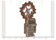
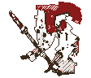
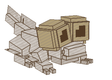
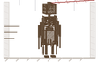
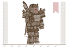
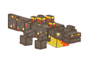
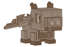
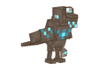

<p align="center">
  <h1 align="center">Coraline</h1>
  <p align="center">
    <em>Um conto feérico de cinzas, névoa e antigas barganhas.</em>
  </p>
</p>

<p align="center">
  
</p>

<p align="center">
  <em>"Não saia da trilha batida. Não aceite presentes sem barganha.<br>E nunca, sob hipótese alguma, apague a chama na borda do charco."</em><br>
  <sub>— anotação na margem do Bestiário, em letra trêmula e apressada</sub>
</p>

---

Atravessei a fronteira num fim de tarde cinzento, quando o horizonte ainda parecia familiar. O mundo além do limiar não é feito de monstros comuns; ele obedece a uma corte antiga, caprichosa e indiferente, onde a beleza e o pavor compartilham a mesma raiz retorcida. 

Voltei com este diário para registrar o que vi nas matas, nas pedras e no fogo. Se você pretende atravessar a mesma fronteira, guarde consigo as três leis que os viajantes de antanho sussurravam antes de anoitecer:

> **I. O ferro fere o Povo Antigo.** Carregar o metal frio é insulto e blasfêmia aos olhos dos que dançam na névoa.  
> **II. Toda dádiva cobra seu preço.** O que parece ouro sob a folhagem cobra seu peso em sangue ou fôlego antes do amanhecer.  
> **III. O que tem nome pode ser chamado.** Certas coisas dormem no escuro; tocar em suas relíquias esquecidas é convidá-las a despertar.

·  ·  ·

### Capítulo I — Ao Entardecer

<p align="center">
  
</p>

O primeiro sinal nunca é a criatura, mas o riso rouco que ecoa entre as ruínas esquecidas.

Pertencentes à Corte Sombria das velhas fronteiras, os **Barretes Vermelhos** (*Redcaps*) não conhecem o arrependimento. Calçam botas de ferro pesado — o próprio metal que fere as fadas, transformado em escárnio — e nunca andam sozinhos. O barrete de pano que trazem sobre a cabeça precisa ser banhado em sangue fresco para não definhar; por isso, avançam em bando em torno de suas vítimas. Se você avistar um barrete rubro jogado na relva úmida, passe ao largo: certas mortalhas não devem ser vestidas.

Nas bordas das velhas árvores, o riso às vezes dá lugar ao farfalhar seco dos **Micos de Casca**, pequenas sentinelas de madeira viva que vigiam a marcha dos intrusos com olhos reluzentes.

·  ·  ·

### Capítulo II — Charcos e Cavernas

<p align="center">
  
</p>

Onde a água apodrece e a luz não alcança, o ar se torna pesado.

Nos pântanos densos e nas galerias sem céu, o **Basilisco da Praga** rasteja sobre a lama com ventre viscoso e dois cistos dourados colossais que nunca piscam. Seus olhos verdadeiros são quase cegos, mas seu papo infla com sibilos profundos antes de golfar uma névoa escura que apodrece a carne e rouba a visão em instantes. Os antigos aprenderam a erguer tochas ou lanternas de fogo das almas: diante da chama espectral, o réptil recua acuado — a menos que seja ferido, momento em que seu medo se extingue na fúria.

Mais fundo ainda, onde o gotejamento ecoa nas fendas verdejantes e estalactites pontiagudas, o **Litófago** repousa fundido à rocha. Criatura de placas de escória e garras de pedra, ele não se move por malícia, mas por peso e ressonância; quando vários despertam juntos, seus passos cantam na terra em ondas de choque tectônicas.

·  ·  ·

### Capítulo III — A Noite nas Árvores

<p align="center">
  
</p>

Há coisas que dormem nas florestas escuras e antigas porque os séculos esqueceram seus nomes. Mas os rituais permanecem.

Se você erguer o *Ídolo do Tronco Oco* sob a copa fechada de uma taiga à meia-noite, a floresta responde. O **Quebra-Copas** não caminha pelo chão como os homens: ele corre pelas alturas, dobra galhos centenários e despenca sobre a terra com a violência de uma tempestade, brandindo o Porrete de Raiz-Morta contra qualquer um que profane o silêncio da madeira ancestral.

E ainda mais adentro, onde as teias se misturam à névoa de jardins pálidos, um fuso solitário gira sem mãos.

<p align="center">
  
</p>

Tocar o *Fuso Amaldiçoado* sob o dossel noturno convoca **Ester, a Matriarca Costureira**. A Bruxa dos Dez Fios não luta de imediato com suas próprias mãos: ela ergue uma arena de agulhas e comanda, uma a uma, dez marionetes nascidas de suas tragédias — a Noiva Oca, o Cão de Porcelana, a Mãe das Raízes, o Gigante do Berço. Cada alma é amarrada por um fio carmesim visível apenas no momento do golpe. Somente cortando cada fio com paciência e ferro o viajante poderá alcançar o coração do tear.

·  ·  ·

### Capítulo IV — Onde a Neve Escuta

<p align="center">
  
</p>

Na taiga nevada, o silêncio do gelo é tão denso que parece engolir os passos.

Existe um objeto conhecido como o *Sino Mudo*. Ele não tem badalo e não emite som que ouvidos humanos possam escutar; mas, repousado sobre o gelo compactado na calada da noite, ele reverbera no Outro Lado.

O céu se parte e, pelo ar gélido, desce em um trenó colossal o **Cobrador da Última Dádiva**. Ele não vem por ira, nem por ódio: vem exigir o tributo solene de quem colheu do mundo mais do que deixou para trás. Em duas fases coreografadas sob nevascas implacáveis, a batalha é um teste de fôlego e respeito às leis do inverno eterno.

·  ·  ·

### Capítulo V — Fundo, Mais Fundo

<p align="center">
  
</p>

Abaixo de onde as raízes terminam, nos salões esquecidos de ardósia profunda, descansa a *Insígnia do Juramento Manchada*.

Oferecida sobre os tijolos escuros, ela convoca o **Comandante Carmesim**: um cavaleiro colossal sem corte e sem rei, cuja armadura partida ainda ecoa juramentos de sangue. Seus ataques não admitem descuido: cada golpe de sua espada larga exige leitura paciente de fintas, aparadas e contra-ataques precisos contra suas sentinelas de cinza.

E quando a terra finalmente cede lugar às fornalhas do Nether, as margens de basalto e lagos incandescentes revelam a **Salamandra de Enxofre**:

<p align="center">
  
</p>

Criaturas nascidas do fogo primordial, elas rastejam pelas margens de cinzas cuspindo alcatrão viscoso sobre invasores. Seus bandos protegem ninhadas de filhotes tenros com fúria cega; qualquer ameaça às crias desperta os adultos em perseguição implacável, enquanto os pequenos aprendem a mergulhar nos rios de magma velozes como faíscas.

·  ·  ·

### Capítulo VI — Os que Caminham ao Seu Lado

<p align="center">
  
</p>

Nem toda sombra do Outro Mundo deseja sangue; algumas buscam lealdade e pactos firmados à beira do fogo.

- **O Dragão Bebê — *A Chama Adormecida*:** Pequeno, curioso e frágil, ele é conquistado com salmão fresco e escolhe descansar sobre o ombro de seu protetor. Através de uma jornada de aprendizado e experiência, ele cresce: de um filhote que brinca com brasas a um jovem impetuoso, até desdobrar asas adultas como montaria majestosa de sopro infernal. *(Em forja e refinamento contínuo nas oficinas feéricas)*.
- **O Corvo Feérico — *A Sentinela Mística*:** Pássaro de plumagem crepuscular atraído pelo brilho das bagas luminosas. Quando firma pacto com um viajante, voa em busca de relíquias cintilantes e empoleira-se nas frestas para sussurrar alertas contra presenças invisíveis que espreitam no ar.

·  ·  ·

### Capítulo VII — O Tomo das Sombras

<p align="center">
  
</p>

O conhecimento é a única armadura que não atrai a ira das fadas.

Nas páginas do **Bestiário** in-game, encadernado em couro e pergaminho rústico, o viajante encontrará gravuras talhadas à mão, estudos anatômicos, conselhos de sobrevivência e as lendas de cada criatura que caminha por este mundo. Carregue-o consigo; no escuro das matas, quem não sabe o que enfrenta já perdeu a caminhada.

---

<details>
<summary><strong>✦ Para quem forja o mundo (Informações Técnicas e Instalação)</strong></summary>

<br />

### Requisitos e Versões
| Componente | Versão | Notas |
|---|---|---|
| **Minecraft** | `26.1.2` | Java Edition |
| **Mod Loader** | `NeoForge 26.1.2.124` | Obrigatório |
| **Java Toolchain** | `Java 25` | Provisionado automaticamente pelo Gradle |
| **Gradle Wrapper** | `9.2.1` | Plugin `net.neoforged.moddev 2.0.148` |
| **Mod ID Interno** | `codenamecoraline` | Nome de projeto provisório |

### Como Executar em Desenvolvimento
```bash
# Compilar e empacotar o mod:
./gradlew build

# Iniciar o cliente de testes com o mod carregado:
./gradlew runClient

# Executar suítes de testes de validação lógica (GameTests):
./gradlew runBrimstoneSalamanderTest
./gradlew runTenThreadsWitchTest
./gradlew runBabyDragonTest
```
*(No Windows PowerShell, utilize `.\gradlew.bat <comando>`)*

### Documentação e Arquitetura do Repositório
- [docs/ARCHITECTURE.md](docs/ARCHITECTURE.md) — Filosofia técnica e organização de pacotes.
- [docs/DECISIONS.md](docs/DECISIONS.md) — Registro imutável de decisões de engenharia.
- [docs/DEVELOPMENT.md](docs/DEVELOPMENT.md) — Manual de comandos, validação e GameTests.
- [docs/CURRENT_STATE.md](docs/CURRENT_STATE.md) — Resumo de estado do desenvolvimento.

</details>
